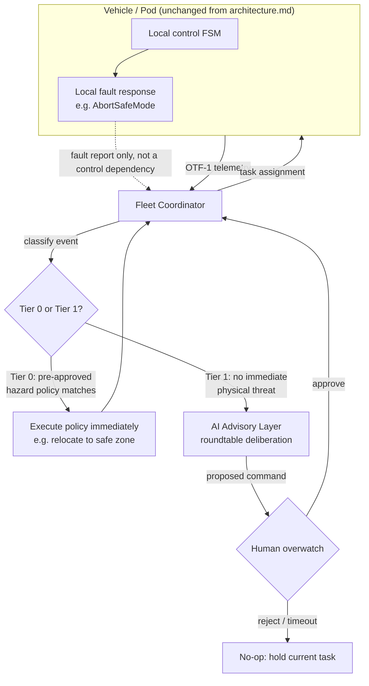

# AI Advisory Layer — Draft

Not built. This records a design direction and, more importantly, hard
boundaries on where AI reasoning is and isn't allowed to sit in this
system — including the boundary between "needs deliberation" and "needs
to happen right now, no deliberation allowed."

## Two tiers, not one pipeline

The first draft of this doc had a single pipeline (event → AI deliberates
→ human approves → dispatch) with "no response in time" defaulting to
inaction. That's wrong for time-critical physical hazards: if a nearby
collision throws debris toward a mining site, inaction *is* the dangerous
option, not the safe one. But the fix isn't making the AI roundtable
faster or letting it auto-execute on a timeout — a multi-round LLM
deliberation auto-committing the fleet to an unreviewed action on timeout
is a worse failure mode, not a better one. The fix is recognizing these
are two different kinds of decisions:

| | Tier 0 — Time-Critical Hazard Response | Tier 1 — Deliberative Advisory |
|---|---|---|
| Examples | Incoming debris/collision risk, imminent structural threat | Task prioritization, resource-allocation conflicts, mission replanning |
| Decision made when | In advance, as certified policy | At the time of the event |
| Response time | Immediate, automatic | Minutes to hours is fine |
| Who/what decides in the moment | Nobody -- a pre-approved rule fires | AI roundtable proposes, human approves |
| Precedent | TCAS (aircraft collision avoidance) commands evasive maneuvers without waiting for pilot approval, because the maneuver logic was certified years in advance | The original single-pipeline draft below |

Tier 0 is not "the AI decides fast." It's "humans already decided the
policy, and the system just executes it the instant the trigger condition
is met" -- the same shape as `ShuttleFSM::AbortSafeMode`, just triggered by
an external threat (incoming debris) instead of an internal fault (MHD
over-temp). It never touches the AI advisory layer or a human-in-the-loop
review, because waiting for either is the failure mode it exists to avoid.

Tier 1 is the deliberative "roundtable" layer described below, unchanged
in spirit from the first draft -- it's for decisions where taking a few
minutes costs nothing.

## What Tier 1 (the roundtable) is

An optional, event-triggered, multi-agent deliberation layer for
fleet-level decision *support* on non-urgent questions. Several LLM-backed
agent roles debate a question, critique each other's proposals, and vote
to a consensus recommendation, the same "roundtable" shape as a separate
local prototype (`ai-chat-network`, built on Jaseci/Jac: a
`RoundtableSession` walker runs multiple deliberation rounds, a critique
phase, then a vote). That project's chat/web-app code isn't being pulled
into this repo -- the transferable idea is the deliberate, multi-round,
vote-to-consensus *pattern*, reimplemented for fleet decisions rather than
open-ended chat.

## What neither tier is

**Not part of the safety-critical control path. Never runs on the pods
themselves. Never gates a pod's local fault response.** This applies to
Tier 0's policy-execution logic too, not just Tier 1's AI roundtable --
see the next section.

## Why that boundary is non-negotiable

A pod's own compute goes down when the pod loses power. If any reasoning
-- AI or otherwise -- that a pod's safety response depends on were
co-located on the pod itself, the failure that most needs a safety
response is exactly the failure that takes that reasoning down with it.

`architecture.md`'s Design Principle #1 already says no node can depend on
the *fleet coordinator* for safety-critical decisions. This extends the
same rule further: no node can depend on the *AI advisory layer* either,
and even Tier 0's fast policy execution runs at the coordinator/ground
tier, not as a dependency the pod itself needs to survive -- a pod facing
an immediate local threat (e.g. its own containment failing) still relies
on its own onboard `AbortSafeMode`/`Fault` state, full stop. Tier 0 is for
threats the *coordinator* detects and must act on across multiple pods
(an incoming debris field affecting a whole mining site), not a substitute
for pod-local fault handling.

## Tier 1: event-based commands + human overwatch

- Inactive by default. Activates only on specific non-urgent fleet events
  (a resource-allocation conflict between pods, an anomaly report worth
  discussing, a replanning trigger) -- not a continuous control loop.
- Output is a **proposed** command, never a directly-actuated one. It
  enters a review queue; a human approves or rejects before the fleet
  coordinator dispatches anything.
- If no human responds in time, the default is **inaction** (hold current
  task). This timeout-to-inaction rule applies *only* to Tier 1 -- it was
  wrong as a blanket rule across all events, which is the whole reason
  this doc now has two tiers instead of one.

Tier 0's path never touches the AI layer or human review -- that's the
point. A pod's own local fault response never routes through any of this
diagram either; it reports upward for awareness, but the response already
happened before that report is sent.

## Not decided yet

- **The actual list of Tier 0 trigger conditions and their policies** --
  this needs to be enumerated and reviewed by humans in advance (the
  "collision risk above X within Y minutes -> relocate to nearest
  pre-designated safe zone" example is illustrative, not a real
  threshold). Nothing gets classified as Tier 0 informally; it has to be
  a deliberate, reviewed list, precisely because Tier 0 skips real-time
  human review.
- How "pre-designated safe zones" get chosen and kept up to date as the
  fleet's operating area changes.
- Which specific non-urgent events warrant Tier 1 deliberation vs. staying
  entirely within the coordinator's own deterministic logic.
- Human-review timeout/expiry policy for Tier 1.
- What agent roles make sense for Tier 1 fleet decisions -- the local
  prototype's roles were civic/community-oriented; fleet decisions need
  different expertise framing (logistics, safety officer, resource
  economics), not a direct reuse of that role set.
- One fleet-wide Tier 1 roundtable vs. scoped per-domain (mining-fleet
  decisions vs. transport scheduling might not belong in the same
  deliberation).
