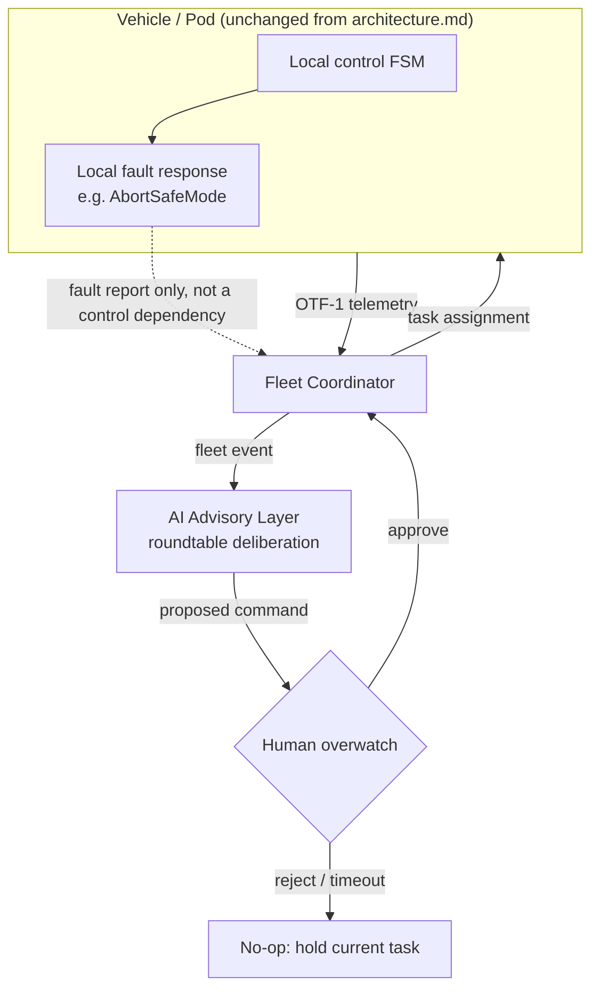

# AI Advisory Layer — Draft

Not built. This records a design direction and, more importantly, a hard
boundary on where AI reasoning is and isn't allowed to sit in this system.

## What this is

An optional, event-triggered, multi-agent deliberation layer for
fleet-level decision *support* — task prioritization, anomaly triage,
mission-replanning recommendations. Several LLM-backed agent roles debate
a question, critique each other's proposals, and vote to a consensus
recommendation, the same "roundtable" shape as a separate local prototype
(`ai-chat-network`, built on Jaseci/Jac: a `RoundtableSession` walker runs
multiple deliberation rounds, a critique phase, then a vote). That
project's chat/web-app code isn't being pulled into this repo — the
transferable idea is the deliberate, multi-round, vote-to-consensus
*pattern*, reimplemented for fleet decisions rather than open-ended chat.

## What this is not

**Not part of the safety-critical control path. Never runs on the pods
themselves. Never gates a pod's local fault response.**

## Why that boundary is non-negotiable

A pod's own compute goes down when the pod loses power. If any AI
reasoning were co-located on the pod and something upstream of it
(propulsion, containment, whatever) depended on that reasoning, the
failure that most needs a safety response is exactly the failure that
takes the AI down with it — the worst possible time for it to go silent.

`architecture.md`'s Design Principle #1 already says no node can depend on
the *fleet coordinator* for safety-critical decisions. This extends the
same rule one layer further up: no node can depend on the *AI advisory
layer* either. `ShuttleFSM::AbortSafeMode` and `MinerPodFSM::Fault` must
keep working with zero dependency on AI, the fleet coordinator, or network
connectivity — full stop. The AI layer runs on ground/coordinator-tier
infrastructure, never on vehicle/pod-tier hardware, and a pod's fault path
never routes through it.

## Event-based commands + human overwatch

- Inactive by default. It activates only on specific fleet-level events
  (a resource-allocation conflict between pods, an anomaly report, a
  replanning trigger) — not a continuous control loop making ongoing
  decisions.
- Output is a **proposed** command, never a directly-actuated one. It
  enters a review queue; a human approves or rejects before the fleet
  coordinator dispatches anything to the fleet.
- If no human responds in time, the default is **inaction** (hold current
  task) — never auto-executing the proposal after a timeout. The exact
  timeout isn't decided; the fallback direction is.

Note the local fault response never routes through the coordinator, the
AI layer, or human review — it reports upward for awareness (telemetry),
but the response itself already happened locally before that report is
even sent.

## Not decided yet

- Which specific events warrant AI deliberation vs. staying entirely
  within the coordinator's own deterministic logic.
- Human-review timeout/expiry policy.
- What agent roles make sense for fleet decisions -- the local prototype's
  roles were civic/community-oriented; fleet decisions need different
  expertise framing (logistics, safety officer, resource economics), not
  a direct reuse of that role set.
- One fleet-wide roundtable vs. scoped per-domain (mining-fleet decisions
  vs. transport scheduling might not belong in the same deliberation).
