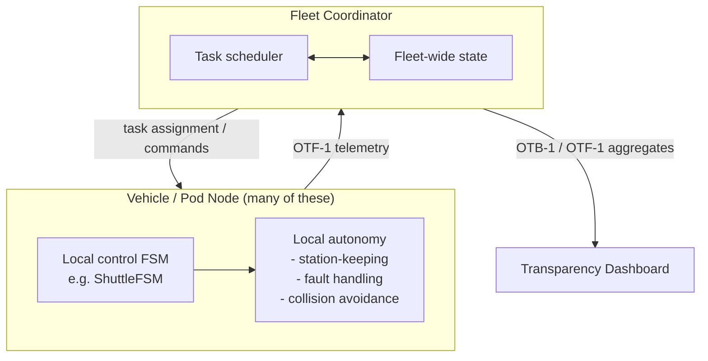

# Draft Architecture

Initial sketch, not a finalized design -- see the open questions in the
[README](../README.md).

## Design principles (draft)

1. **Local autonomy first.** Given light-delay between Earth and cislunar/
   belt operations, no node can depend on the coordinator -- or on the
   [AI advisory layer](ai-advisory-layer-draft.md) above it -- for
   safety-critical decisions (collision avoidance, fault response). Those
   stay local, using the same pattern as `ShuttleFSM`'s `AbortSafeMode`.
   A pod's own compute goes down with its own power failure; nothing its
   safety response depends on can live anywhere but on the pod itself.
2. **OTF-1 as the only wire format.** Nodes report status and coordinator
   sends assignments using [`telemetry-protocol`](https://github.com/Overby-Industries/telemetry-protocol)'s
   schema, rather than a bespoke protocol per node type.
3. **Coordinator failure shouldn't halt the fleet.** Nodes should degrade
   to a locally-defined default task (station-keeping, continue current
   task to completion) rather than stopping, if contact is lost.

## What's not decided yet

- Consensus/coordination algorithm for the fleet coordinator itself (single
  point of failure vs. replicated).
- Whether "the coordinator" is one role or several (mining coordination vs.
  transport scheduling vs. safety monitoring might not be the same system).
- Target hardware/OS for coordinator nodes vs. embedded vehicle nodes
  (likely very different constraints -- see `power-and-propulsion/firmware`
  for the embedded end of that spectrum).
