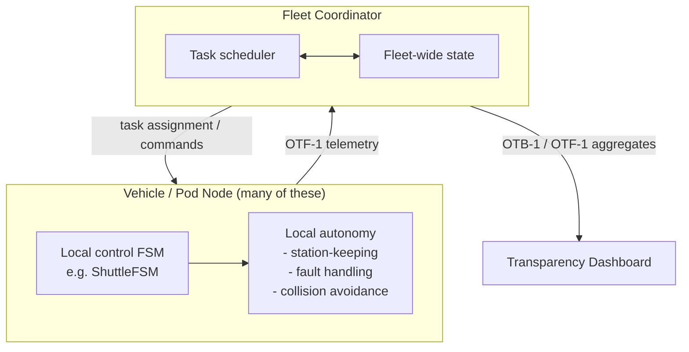

# Draft Architecture

Initial sketch, not a finalized design -- see the open questions in the
[README](../README.md). A first slice of it is built: the node-side fleet
agent, the coordinator, and OTF-1 between them. How that slice behaves is
recorded in [`fleet-coordination.md`](fleet-coordination.md); the section
[What the first slice implements](#what-the-first-slice-implements) below
says which parts of this sketch it covers.

## Design principles (draft)

1. **Local autonomy first.** Given light-delay between Earth and cislunar/
   belt operations, no node can depend on the coordinator -- or on the
   [AI advisory layer](ai-advisory-layer-draft.md) above it -- for
   safety-critical decisions (collision avoidance, fault response). Those
   stay local, using the same pattern as `ShuttleFSM`'s `AbortSafeMode`.
   A pod's own compute goes down with its own power failure; nothing its
   safety response depends on can live anywhere but on the pod itself.
2. **OTF-1 as the only wire format.** Nodes report status and coordinator
   sends assignments using [`telemetry-protocol`](https://github.com/Overby-Industries/telemetry-protocol)'s
   schema, rather than a bespoke protocol per node type.
3. **Coordinator failure shouldn't halt the fleet.** Nodes should degrade
   to a locally-defined default task (station-keeping, continue current
   task to completion) rather than stopping, if contact is lost.

## What the first slice implements

| In the sketch | In the code | Notes |
|---|---|---|
| Local control FSM | `LocalControl` (`include/starlifter/local_control.hpp`) | An interface only. The simulation uses a stand-in pod. A `ShuttleFSM` adapter is not written. |
| Local autonomy | `Node` (`include/starlifter/node.hpp`) | Covers what a node does about *fleet* matters when alone: finish the task, hold the default, keep the record. Station-keeping and collision avoidance stay behind `LocalControl`. |
| OTF-1 telemetry, task assignment / commands | `otf1::encode()` / `otf1::decode()` from libotf1, in the `telemetry-protocol` submodule | Assignments are offers a node may refuse, not commands. This repo has no codec of its own. |
| Task scheduler, fleet-wide state | `Coordinator` (`include/starlifter/coordinator.hpp`) | One coordinator, state in memory. |
| OTB-1 / OTF-1 aggregates to the dashboard | `Coordinator::feed()`, `Coordinator::summary()` | The feed is every completed-work event, verbatim. `starlifter_publish` records it in an Overby Ledger and stamps each event; nothing yet displays it. |

How each principle is held, rather than only stated:

1. **Local autonomy first.** `LocalControl` gives the fleet layer no way to
   command a mode change, clear a fault, or interrupt a fault response. The
   agent can ask local control to begin a task and can read its state;
   that is all. A vehicle that safes itself fails its task and says so, and
   the coordinator learns of it afterwards.
2. **OTF-1 as the only wire format.** The agent and the coordinator pass
   each other strings and nothing else, and neither acts on a string its
   decoder rejects. Getting there required extending OTF-1, which until now
   described only mission events: `telemetry-protocol` gained the `status`,
   `heartbeat`, `assignment` and `ack` packet kinds.
3. **Coordinator failure shouldn't halt the fleet.** A node's handling of
   the task in hand never consults the link. The test "with every link
   down at once, nodes keep working and the picture catches up" takes the
   coordinator away from every node at once, mid-task, and requires each
   task to be finished and recorded exactly once.

One principle was added by building it, and belongs beside the three above:

4. **A task leaves a node only on evidence.** The coordinator never
   reassigns work because a node went quiet. See
   [`fleet-coordination.md`](fleet-coordination.md#a-task-leaves-a-node-only-on-evidence).

## What's not decided yet

The first slice runs a single in-memory coordinator because that is the
least it could run. It does not settle any of the following.

- Consensus/coordination algorithm for the fleet coordinator itself (single
  point of failure vs. replicated).
- Whether "the coordinator" is one role or several (mining coordination vs.
  transport scheduling vs. safety monitoring might not be the same system).
- Target hardware/OS for coordinator nodes vs. embedded vehicle nodes
  (likely very different constraints -- see `power-and-propulsion/firmware`
  for the embedded end of that spectrum).
