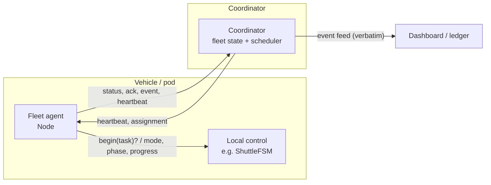
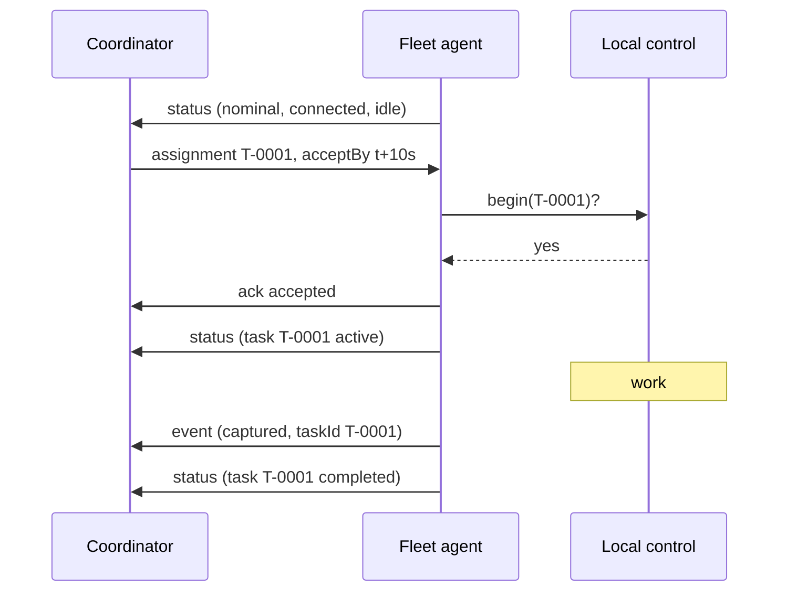
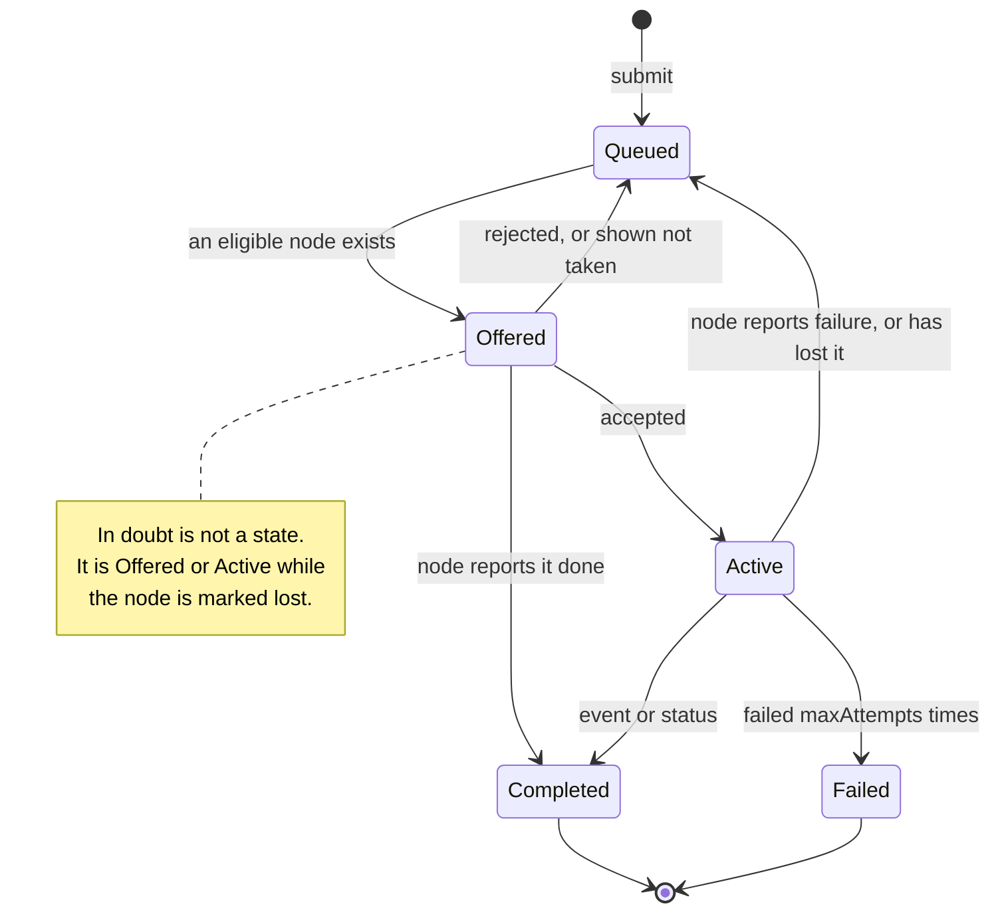

# Fleet Coordination

How the first slice behaves, rule by rule. [`architecture.md`](architecture.md)
is the sketch of the whole system; this is the record of the part that is
built, and of why it behaves the way it does.

Everything here is implemented in `include/starlifter/` and held in place by
a test in `tests/`. Where a rule exists because of a specific failure, the
failure is named.

## The pieces

- **Local control** belongs to the vehicle. It flies, it detects faults, it
  decides when to safe itself. It works with no fleet software running.
- **The fleet agent** (`Node`) is the part of Starlifter OS on the vehicle.
  It reports, answers offers, and holds no authority over the vehicle.
- **The coordinator** keeps the fleet-wide picture and offers queued tasks
  to nodes that can take them.

The agent and the coordinator exchange nothing but strings of OTF-1. Neither
hands the other an object, and neither acts on a string its decoder rejects.

## The packets

All five are OTF-1 and are defined in
[`telemetry-protocol`](https://github.com/Overby-Industries/telemetry-protocol),
which also holds libotf1, the C++ that encodes and decodes them. This repo
takes it as a submodule; `include/starlifter/wire.hpp` names the types the
fleet layer uses.

| Kind | Direction | Purpose |
|---|---|---|
| `status` | node to coordinator | A complete snapshot of the node: health, link view, capabilities, location, and the task it holds or last finished |
| `heartbeat` | either way | Liveness. The coordinator broadcasts one; a node may send one between statuses |
| `assignment` | coordinator to node | An offer of one task, valid until `acceptBy` |
| `ack` | node to coordinator | The answer to an offer: accepted, or rejected with a reason |
| `event` | node to coordinator | Completed work. The original OTF-1 packet, and the public record |

A normal assignment:

## What a node does

1. **It reports a full snapshot, not a change.** Every status carries
   everything, including the outcome of the last task until a newer task
   replaces it. A coordinator that missed any number of packets is fully
   caught up by the next one. This is what makes a lossy link survivable
   without retransmission.

2. **It reports on a timer and at once on any change** of health, link view
   or task state.

3. **It takes an offer at most once.** An assignment packet delivered twice
   is recognised by its sequence number, task and deadline and is ignored.
   An offer of the task it is already doing gets the same acceptance again
   and the work is not restarted. An offer of a task it has already
   completed gets a status saying so. Refusing it would invite the
   coordinator to send another node after work that is done.

4. **It refuses what it cannot do, and says why.** In order: the offer
   arrived after `acceptBy` (`expired`); the vehicle is in safe mode
   (`safe-mode`) or degraded (`degraded`); it is already working
   (`busy`); it lacks the capability or is in the wrong zone
   (`unsupported`); local control declined (`refused`).

5. **Local control has the final say.** After every check the agent can
   make, it asks. A vehicle that is not nominal is not even asked.

6. **Losing contact changes nothing about the work in hand.** With no
   coordinator packet for `contactTimeoutMs` the node reports its link view
   as `autonomous`. It finishes its task and then holds its local default.
   Its code for working on a task does not consult the link at all.

7. **It holds the record until someone can hear it.** Events for completed
   work stay on board while the link view is `autonomous` and go out when
   the coordinator is heard again. Status keeps going out regardless,
   because the node cannot know that its own transmissions are the half of
   the link that failed.

8. **A vehicle that safes itself has failed its task,** whatever local
   control goes on to report. No event is produced: an event claims that
   something happened to material, and nothing did.

9. **It obeys one coordinator.** Packets from any other source, or addressed
   to any other node, are counted and dropped.

## What the coordinator does

### Who can be offered a task

A node is eligible for a task only if all of these hold:

- it is in contact, and its own status says its link is `connected`
  (an offer to a node that cannot hear is wasted);
- it reports itself `nominal`;
- it has no offer or task outstanding with this coordinator, and does not
  report itself busy with anything else;
- it has not just refused an offer without reporting since;
- it is in the task's zone and advertises the task's action;
- it has not told the coordinator never to offer it this task again.

Tasks are offered oldest first. Among eligible nodes, the one that has gone
longest without an offer gets it; ties break by node id, so a run is
reproducible.

Capabilities are advertised by each node in its status. The coordinator has
no table of what a node type can do, so a new kind of node needs no change
here.

### The accept deadline

Each offer carries `acceptBy = now + observed link delay + acceptWindowMs`.
The link delay is measured from the node's last status. A node must refuse
an offer that arrives later than that.

The deadline does two jobs. It bounds how stale an offer can be when it
lands. And it gives the coordinator a way to reason about an unanswered
offer, which the next section depends on.

### A task leaves a node only on evidence

This is the rule the design turns on.

When a node holding a task stops being heard from, the coordinator cannot
tell "the node is dead" from "the node is fine and working, and the link is
down". Across light-minutes and through outages, the second is the ordinary
case. A scheduler that reassigned on a timeout would routinely send two
vehicles after the same piece of debris.

So there is no timeout that reassigns work. Marking a node lost changes how
it is reported and stops new offers to it. It moves nothing.

| What the coordinator receives | What it concludes | The task becomes |
|---|---|---|
| `ack` accepted | the node took it | active |
| `status` listing the task as active | the node took it | active |
| `event` carrying the task's id | the work is done | completed |
| `status` listing the task as completed | the work is done | completed |
| `ack` rejected | the offer was not taken | queued |
| `status` listing the task as failed | the node abandoned it | queued, or failed after `maxAttempts` |
| `status` sent after `acceptBy` that does not list an unanswered offer | the offer was never taken | queued |
| `status` newer than the acceptance that no longer lists the task | the node lost it, most likely a restart | queued, counted as a failure |
| nothing | nothing | unchanged, and shown as **in doubt** once the node is marked lost |

Two of those rows deserve a word.

*The unanswered offer.* A node may take an offer only before `acceptBy`. So
a status the node sent after that instant reflects its final decision. If
the task is not in it, the offer was not taken, whether the offer or the
answer was the packet that got lost. This is how a lost offer is recovered
without a retransmission timer. `clockSkewMarginMs` is added to the
comparison because it sets two clocks against each other.

*In doubt.* A task offered to, or held by, a node that has gone silent is
visible and counted and stays exactly where it is. If the node comes back,
its next status settles the matter by one of the rows above. If it never
does, the task waits. Deciding to release it anyway is a judgement about
risk: is duplicated work worse than undone work, for this task, now? That
is a question for the advisory layer and a human
([`ai-advisory-layer-draft.md`](ai-advisory-layer-draft.md)), not for a
scheduler. It is not built.

### Task lifecycle

### Order, duplicates and restarts

Packets arrive late, twice, and out of order.

- **A node's packets are ordered by timestamp, then by `seq`.** A status or
  heartbeat that is not newer than what has already been applied is
  dropped. Timestamp comes first so that a node which restarts and counts
  from zero is still understood.
- **An `ack` advances that order too.** The case this exists for: a status
  sent just before a node took a task arrives just after its acceptance.
  Read naively it says "I do not have that task" and would send the work to
  someone else. Because the acceptance advanced the node's position, the
  older status is discarded.
- **An `ack` is never dropped for being old.** It is not a snapshot, and
  handling one twice is harmless.
- **An `event` is recorded once** per pod and task, however often it
  arrives. Otherwise a repeated packet would double the mass counted toward
  the cleanup index.

### Things that should not happen

A node reporting work on a task that is assigned to another node, or that
this coordinator never issued, is recorded as a conflict and nothing else is
done. There is no cancel message, and guessing which side is right is how a
second vehicle gets sent. The simulation exits non-zero if a run produces
one.

### The public record

`Coordinator::feed()` holds every completed-work event, verbatim and in arrival
order. It is the only thing that leaves the fleet as record; status, heartbeat,
assignment and ack are bookkeeping and stay inside it.

`starlifter_publish` (`include/starlifter/ledger_feed.hpp`) records that feed in
an Overby Ledger through the ledger's OTF-1 bridge. Each event becomes a named
entry for its pod whose detail commits to a SHA-256 digest of the event, and the
event comes back with the entry's coordinate in its `ProofOfCleanupToken`.

Three properties of the coordinator carry through to the record:

- **One event per task and pod.** The coordinator records a completion once
  however often it arrives, so the feed has no duplicates to double-count. The
  ledger independently refuses to record the same event twice, so a replayed or
  re-sent feed is harmless.
- **An event is dated when the work happened.** A node holds its completion on
  board through an outage and sends it when contact returns; its timestamp is
  the instant of completion, and that is what the ledger records.
- **A failed task is not a record.** A vehicle that safes itself mid-task
  produces no event, because an event claims something happened to material.

## Timing

Defaults, all configurable.

| Setting | Default | Where | Meaning |
|---|---|---|---|
| `statusIntervalMs` | 5 s | node | Longest gap between statuses |
| `contactTimeoutMs` | 15 s | node | Silence after which a node calls itself autonomous |
| `heartbeatIntervalMs` | 5 s | coordinator | Gap between coordinator heartbeats |
| `nodeTimeoutMs` | 20 s | coordinator | Silence after which a node is marked lost |
| `acceptWindowMs` | 10 s | coordinator | Time a node has to take an offer once it arrives |
| `clockSkewMarginMs` | 1 s | coordinator | Allowed disagreement between a node's clock and the coordinator's |
| `maxAttempts` | 3 | coordinator | Failures after which a task is not offered again |

Link delay does not enter into either timeout. A constant delay shifts when
packets arrive, not how far apart they arrive.

## What this rests on

- **Clocks agree to within `clockSkewMarginMs`.** The conclusion that an
  offer was never taken compares a node's timestamp with the coordinator's
  deadline. A node whose clock runs far ahead could have that conclusion
  drawn about an offer it then accepts. Nothing here measures or corrects
  skew.
- **Senders are who they say they are.** There is no authentication.
- **The coordinator does not restart.** Its state is in memory.
- **One coordinator.** A node is configured with a single coordinator id.

Each of these is listed under "Not Built Yet" in the [README](../README.md).

## Where each rule is tested

| Rule | Test |
|---|---|
| A node takes an offer at most once | `tests/node_tests.cpp`: "a duplicated or repeated offer never starts the work twice" |
| The vehicle has the final say | `tests/node_tests.cpp`: "an offer is refused, with the reason, whenever the vehicle cannot or will not" |
| Losing contact changes nothing about the work | `tests/node_tests.cpp`: "out of contact, a node finishes its task and holds the record until heard" |
| Silence is never evidence | `tests/coordinator_tests.cpp`: "a task held by a silent node is in doubt -- and is NOT handed to another" |
| A lost offer is noticed without a timer | `tests/coordinator_tests.cpp`: "an offer that was lost is noticed from the node's own status, not from a timer" |
| Out-of-order packets are not applied out of order | `tests/coordinator_tests.cpp`: "packets that arrive out of order are not applied out of order" |
| A returning node settles its own task | `tests/coordinator_tests.cpp`: "when a silent node is heard again, what it says decides the task" |
| An outage mid-task loses nothing | `tests/fleet_tests.cpp`: "a node cut off mid-task finishes alone; the task is not duplicated or lost" |
| Losing the coordinator does not halt the fleet | `tests/fleet_tests.cpp`: "with every link down at once, nodes keep working and the picture catches up" |
| An event feed is recorded once, dated when it happened, and checkable | `tests/ledger_feed_tests.cpp`: a real feed from a fleet with an outage and a fault is published, stamped and verified; replaying it records nothing twice |
| An altered event, or a lifted token, does not verify | `tests/ledger_feed_tests.cpp`: "a stamped event that was altered, or a token lifted from another, does not verify" |
| The decoder and the schema agree | In `telemetry-protocol`, where the codec lives: its C++ tests and `tools/differential.py` |
| Everything the fleet sends is valid OTF-1 | CI validates the simulation's whole wire log against the JSON Schema |
